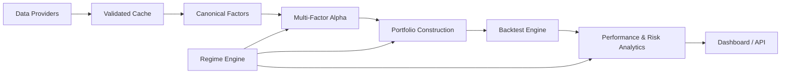

# Systematic Equities Research Lab

**Institutional-Style Multi-Factor Quantitative Research & Portfolio Construction Framework**

Systematic Equities Research Lab is a production-oriented Python research platform for implementing, reproducing, analyzing, and extending foundational academic systematic-equities papers. It is designed like a small buy-side research environment: modular data pipelines, reusable factor definitions, realistic backtesting, portfolio construction, risk analytics, and regime-aware evaluation.

The project is intentionally code-first rather than notebook-only. Notebooks can sit on top of these modules, but the research logic lives in importable, tested Python.

## Implemented Research Pillars

| Paper / Theme | Platform Implementation |
| --- | --- |
| Jegadeesh & Titman (1993) - Momentum | 12-1, 6-month, volatility-adjusted, sector-neutral momentum |
| Fama-French 3-Factor Model | market, size, value primitives |
| Fama-French 5-Factor Model | value, size, profitability, quality-oriented extensions |
| Value and Momentum Everywhere | multi-factor blending and factor correlation diagnostics |
| Momentum Crashes | crash, drawdown, trend, volatility, and HMM-style regime classification |
| Post-Earnings Announcement Drift | SUE calculation and event-study CAR framework |
| Cross-Section of Expected Stock Returns | cross-sectional scoring, z-scoring, IC and decile analytics |
| Statistical Arbitrage in U.S. Equities | pairs trading, hedge ratios, spread z-scores, PCA residuals |
| Quality Minus Junk | ROE, gross profitability, accruals, debt stability, earnings consistency |
| Fundamental Law of Active Management | IC, breadth-ready analytics, information ratio, portfolio construction |

## Architecture

```text
systematic-equities-research-lab/
├── data/                 # ingestion, providers, validation, cache, synthetic demos
├── factors/              # momentum, value, quality, PEAD, stat arb, low vol, size, profitability
├── portfolio/            # weighting, optimization, constraints, regime overlays
├── backtesting/          # vectorized engine, costs, slippage, walk-forward, performance
├── analytics/            # IC, IC decay, drawdowns, turnover, risk exposures
├── regime/               # volatility, trend, drawdown, rolling Sharpe, HMM-style regimes
├── dashboards/           # Streamlit research console
├── app/                  # FastAPI service layer
├── configs/              # typed YAML configuration
├── tests/                # pytest coverage
└── main.py               # reproducible demo research pipeline
```



## Research Philosophy

The lab separates signal research from portfolio implementation. A factor must be measurable cross-sectionally, time-stamped, reproducible, and testable for predictive content before it is allowed into a portfolio. Backtests shift weights by default to reduce lookahead risk, include transaction costs and slippage, and expose turnover as a first-class metric.

## Alpha Generation Framework

The factor stack includes:

- **Momentum:** 12-1, 6-month, volatility-adjusted, sector-neutral.
- **Value:** book-to-market, earnings yield, inverse EV/EBITDA, free cash flow yield.
- **Quality:** ROE, gross profitability, accrual quality, debt stability, earnings consistency.
- **Low Volatility:** realized volatility scoring and beta diagnostics.
- **PEAD:** standardized unexpected earnings and event-window cumulative abnormal returns.
- **Statistical Arbitrage:** hedge ratio estimation, spread z-scores, cointegration diagnostics, PCA residuals.

Every cross-sectional factor is designed to support ranking, z-scoring, IC analysis, decile spreads, long-short weights, and multi-factor blending.

## Backtesting Methodology

The core engine in `backtesting/engine/backtester.py` is vectorized and no-lookahead by default:

- target weights are shifted before applying returns
- turnover is calculated from target portfolio changes
- transaction costs and slippage reduce gross returns
- CAGR, Sharpe, Sortino, Calmar, max drawdown, alpha, beta, hit ratio, turnover, and information ratio are reported
- walk-forward windows are available for rolling retraining and out-of-sample evaluation

## Portfolio Construction Methodology

The portfolio layer supports:

- equal weighting
- inverse volatility weighting
- signal-proportional long-short weighting
- mean-variance optimization
- maximum Sharpe optimization using the canonical \( w^* = \Sigma^{-1}\mu \) form
- risk parity approximation
- gross exposure, position limit, long-only, and dollar-neutral constraints
- regime-based gross exposure overlays

## Risk Management

Risk is treated as a research object, not a postscript. The platform includes drawdown states, rolling Sharpe states, volatility regimes, factor correlations, factor exposure decomposition, beta analytics, turnover diagnostics, and adaptive crash-regime overlays.

## Regime-Aware Extensions

The regime engine classifies:

- volatility states
- bull/bear trend states
- correction and crash drawdown states
- rolling Sharpe states
- HMM-style states, with a quantile fallback when `hmmlearn` is unavailable

These labels can drive dynamic factor weighting, exposure scaling, and crash diagnostics for momentum-heavy portfolios.

## Running The Lab

Install dependencies:

```bash
pip install -r requirements.txt
```

Run the reproducible demo pipeline:

```bash
python main.py --periods 756
```

Start the API:

```bash
uvicorn app.api:app --reload
```

Example endpoints:

```text
GET /factors/momentum
GET /portfolio/weights
GET /backtest/results
GET /regime/current
GET /signals/latest
```

Start the dashboard:

```bash
streamlit run dashboards/streamlit_app.py
```

Run tests:

```bash
pytest
```

## Example Research Flow

```python
from backtesting.engine.backtester import run_backtest
from data.synthetic import adjusted_close_wide, generate_market_panel
from factors.base import long_short_weights
from factors.momentum.signals import twelve_minus_one_momentum

panel = generate_market_panel(periods=756)
prices = adjusted_close_wide(panel)
returns = prices.pct_change(fill_method=None).fillna(0.0)

scores = twelve_minus_one_momentum(prices).scores
weights = long_short_weights(scores).reindex(returns.index).ffill().fillna(0.0)
result = run_backtest(returns, weights)
print(result.metrics)
```

## Data Pipeline

The ingestion layer defines normalized provider contracts for:

- OHLCV and adjusted prices
- splits and dividends through provider extension points
- fundamentals
- macro and regime inputs
- earnings-event data

The initial provider adapters include `YFinanceProvider`, `PolygonProvider`, and `AlphaVantageProvider` abstractions. The synthetic generator provides deterministic demo data for local development, CI, API responses, and dashboard previews.

## Future Roadmap

- Point-in-time fundamentals from licensed datasets
- Survivorship-bias-free universe snapshots
- Broker-grade execution simulation
- Factor crowding and capacity models
- Cross-sectional ML ranking
- Dynamic factor weighting with regime-conditioned priors
- Reinforcement-learning allocation research sandbox
- Alternative data ingestion adapters
- Notebook research templates built on the production modules

