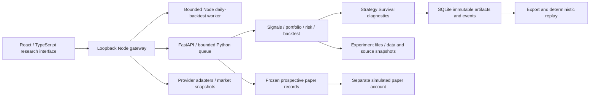

# Q — Reproducible Strategy Research

Q investigates a practical question: **does a strategy's result survive costs, alternative parameters, chronological validation, and statistical scrutiny?** It connects equity signals, constrained portfolios, backtests and a persisted Strategy Survival evidence pipeline. Negative results remain in the experiment book.

The strongest demonstration is the research process, not a profitable backtest. Q does not claim institutional execution readiness, proven alpha, or an untouched holdout from previously inspected data.

## Research workflow

**Data → hypothesis → signal → backtest → statistical validation → execution stress → portfolio/risk review → experiment record → prospective validation.**

- **Eight exposed strategies in three families:** momentum, reversal and volatility, with lagged execution, risk limits and costs.
- **Statistical evidence:** Newey–West/HAC inference, circular block bootstrap, Benjamini–Yekutieli adjustment, conditional DSR and exact CSCV/PBO, each with prerequisites and limitations.
- **Accounting:** fractional portfolio research with drift and transaction costs; separate whole-share, cash-constrained execution stress.
- **Reproducibility:** archived data/configuration/source, dependency fingerprints, append-only Survival results, failed trials, API exports and deterministic export replay.
- **Prospective separation:** frozen paper registrations and a separate simulated paper service; historical results never become prospective or broker-verified observations.
- **Single-strategy projects:** versioned thesis/literature, sealed datasets, every trial, reserved OOS access history, immutable candidate freezes, prospective comparisons and a 21-section research export. Open Research projects in Workspace; see the [lifecycle guide](docs/single-strategy-lifecycle.md).
- **Company intelligence:** frozen PDFs, page citations, reproducible keyword search, local semantic indexes and optional cited AI/news retrieval. See [report evidence and provider setup](docs/company-intelligence.md).
- **Economy lab:** the original native CPU household/firm model, conservation checks and measured scaling studies. See [model and timing methodology](docs/economy-lab.md).

The dashboard has **18 reporting layers**, including unavailable production/live evidence. That does not mean 18 independent tests or 18 passed validation checks.

Read the [audit and readiness report](docs/v2-audit.md), [representative experiment](docs/representative-experiment.md), [browser end-to-end verification](docs/e2e-run.md), and [resume/interview material](docs/resume-and-interviews.md).

The [finalized implementation brief](docs/v2-finalization-prompt.md) and [V2 completion record](docs/v2-finalization.md) define the finite research release and deferred work. **Research projects** is now the default workspace. Its **COMPARE** stage reviews two to four retained attempts with explicit data/date/source/account compatibility checks. Identical dataset recaptures cannot change the reserved boundary. Start with the [five-minute project walkthrough](docs/v2-demo-guide.md).

## Architecture



`apps/engine/research/workspace.py` is the main research entry point; `research/survival/` computes and persists the evidence layers. `apps/web` presents results. `apps/gateway` owns providers, connection state and process management.

Retained strict daily-equity, options, basket, HMM and forecast labs are separate research paths. They do not all share the Survival adapter or accounting conventions. See [the implementation map](docs/implementation.md).

## Run locally

Use **Python 3.12+** and **Node.js 24+**. From a fresh clone on Windows:

```powershell
.\setup-flagship.ps1 -Python python
cd apps\web
npm run install:ci
cd ..\..
.\start-q21.ps1
```

Version 2 uses `http://localhost:5273` and gateway `127.0.0.1:5274`. The launcher refuses occupied ports and pins research/paper storage to this checkout. The gateway owns Python startup on a separate loopback port, including its background paper runner. Historical `q21`/`flagship` names preserve compatibility.

Development is in `C:\quant\terminal-v2`; `C:\quant\terminal` remains version 1. Private state, credentials, past experiments and broker connections were not migrated. [Source hashes](docs/v1-source-snapshot.json) record 347 copied source files, including version 1's uncommitted work.

No provider account is needed for the offline demonstration:

```powershell
cd apps\engine
.\.venv\Scripts\python.exe -m scripts.representative_experiment
```

This creates a new directory under `outputs/research-demo`, exercises the research API, all Survival layers, export replay, a retained rejection and an empty forward registration. Its fixed seed and configuration are not optimized for performance. The output is explicitly **synthetic**; paper promotion remains blocked.

For observed data select Yahoo or configure Massive through backend connections. Provider failures must remain visible; they must not trigger synthetic substitution. Never commit credentials. Native Windows is the verified launch path; this is not a verified cross-platform deployment claim.

## Verify

After dependency setup:

```powershell
.\verify-v2.ps1
```

The script runs Python, web and gateway tests, TypeScript checking and the production build. The optional historical Streamlit UI test is excluded by the existing pytest configuration because that frontend is not part of Q's installed runtime. [Verification evidence](docs/verification.md) records actual results and environment limits.

Individual checks:

```powershell
cd apps\engine
.\.venv\Scripts\python.exe -m pytest
cd ..\web
node --test tests/quant.test.mjs
node node_modules/typescript/bin/tsc --noEmit --incremental false
node node_modules/vinext/dist/cli.js build
```

## Methodology and limits

- [V2 methodology and numerical changes](docs/v2-methodology.md)
- [All Survival layers, formulas and assumptions](docs/strategy-survival.md)
- [Data sources and universe limitations](docs/real-market-data.md)
- [Prospective paper service](docs/paper-trading.md)
- [Architecture audit and feature status](docs/audit-architecture.md)

Historical universes are selected constituents, not point-in-time membership/delisting data. Adjusted history is not an executable quote feed. A chronological split cannot restore independence after repeated inspection. DSR requires a disclosed effective trial count; CSCV covers the recorded candidate set, not unrecorded research. Bootstrap/HAC require dependence and stationarity assumptions. Daily costs and volume caps are modeled approximations, not calibrated impact.

Live submission, production reconciliation/compliance, verified operational alerts and broker-backed performance are **not a complete implemented execution system**. These claims concern local research and simulations only.

